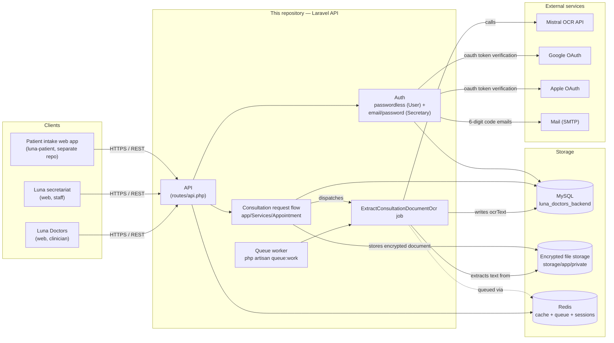

# Architecture

This document describes how the backend fits with the rest of the Luna for Health platform, and where
health data flows. It covers the components that exist in this repository today — not the full product
roadmap (see the main [README](../README.md) for the product-level components).

## Overview

## Components

| Component | Where | Role |
|---|---|---|
| Patient intake web app | separate repo (`luna-patient`) | Collects the intake, consent, symptoms; calls this API as a `User` |
| Luna secretariat / Luna Doctors | web clients (staff-facing) | Call this API as a `Secretary` (role `admin` or `secretary`) |
| API | this repo, `routes/api.php` | Stateless REST API, Sanctum token auth |
| Queue worker | this repo, `php artisan queue:work` | Processes background jobs — currently OCR extraction |
| MySQL | external to this repo | Primary datastore: users, secretaries, consultation requests, documents metadata |
| Redis | external to this repo | Cache, queue driver, session store |
| Encrypted file storage | `storage/app/private` | Uploaded consultation documents, encrypted at rest (`Crypt::encrypt`) |
| Mistral OCR API | external service | Extracts text from uploaded documents (scans, reports, prescriptions) |
| Google / Apple OAuth | external services | Optional sign-in providers for patients |

## Where health data lives and flows

- **In transit**: client → API over HTTPS only.
- **At rest, structured data** (consultation request text, extracted OCR text, user profile): MySQL.
  Encrypted storage and access control are enforced at the hosting layer (see
  [README — Data protection](../README.md#data-protection)); production deployments use a certified
  health-data host (HDS).
- **At rest, documents** (uploaded scans/reports): stored encrypted on disk
  (`storage/app/private/public/consultation-documents`), decrypted only on download by an authorized
  request (owning patient or staff), never served as a plain static file.
- **Leaving the infrastructure**: only the uploaded document content, sent to the Mistral OCR API for
  text extraction. No other third party receives patient data from this backend. OAuth calls to
  Google/Apple exchange an access token for profile fields (name, email) — no health data.
- **Not in this repository**: no patient data, no real centre configuration, no field-test session data.
  A fictional demo centre is used for development and demos (see the main README).

## Not yet covered here

This diagram reflects the backend as it exists today. Components described at the product level but not
yet implemented in this repository (e.g. the clinical routing engine's rule execution, the
centre-configuration tool, speech-to-text for the patient's free-text story) are tracked as
[first issues](../README.md) and will be added to this document as they land.
